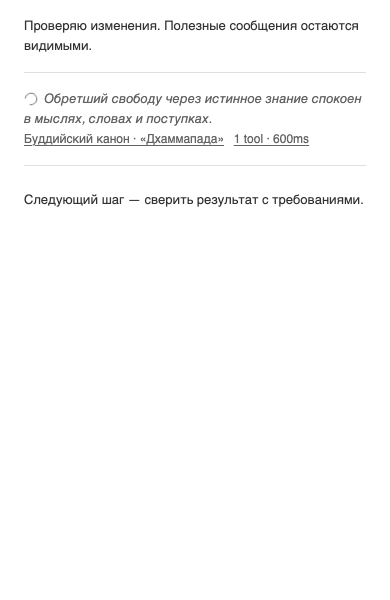
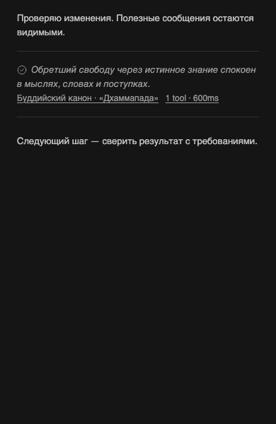

# Иконка выполнения и завершения

Вадик принял предыдущую установленную редакцию: «Теперь работает, оставляем». Затем попросил заменить непонравившийся значок на подходящий: «какой-нибудь тоже пока работает то активная когда всё то закончено». Выбор формы делегирован исполнителю; выбран обычный индикатор выполнения — вращающееся кольцо, переходящее в статическую галочку в круге. Меняется значок сводки инструментов, имя/брендинг плагина не меняются.

Принятая основа — [отступы и разделители](2026-10-30-spacious-dividers.md), [видимый стрим и полные метрики](2026-10-30-summary-membership.md). Сохраняются native серый, размер, перенос и порядок цитата → русский источник → количество и время. Словарь ведёт другой тред и здесь не меняется.

## Поведение

Индикатор относится к инструментам конкретной сводки. Пока хотя бы один её вызов имеет `pending`, кольцо вращается. После завершения всех известных вызовов без ошибки появляется галочка. Подтверждённые `error` и `cancelled` отображаются отдельными статическими знаками. Неполный/недоступный API и неизвестный статус не считаются успешным завершением: используется статическое пунктирное кольцо.

Составные сводки объединяют состояния всех подтверждённых участников, а не только первой API-группы. Terminal refresh меняет значок вместе с завершённым временем; миграция fallback/API сохраняет прежние действия и фокус. Состояние добавлено в доступное описание обеих кнопок по-русски.

## Стиль и motion

| Роль | Источник | Фактическая проверка |
|---|---|---|
| Цвет | `text-subtle-foreground`, как у цитаты | Computed цвета совпали в браузере |
| Размер | Прежний `size-3.5`, native spacing 4 px | CSS width 14 px; вращающийся bounding box не используется как размер layout |
| Штрих | Прежний SVG `currentColor`, native stroke 1.5 | Геометрия SVG, без картинки/шрифта |
| Активность | Native BB `--animate-spin: spin 1s linear infinite` | Запущенная браузерная animation и остановка после terminal |
| Спокойное состояние | Тот же native серый без движения | Снимки обеих тем; opacity-40 снята, поскольку значок теперь передаёт состояние |
| Reduced motion | `prefers-reduced-motion: reduce` | Кольцо остаётся различимым, движение отсутствует |
| Фоновая/невидимая строка | IntersectionObserver + visibilitychange | Animation paused; observer/listener снимаются в cleanup |

`impeccable`: режим Operate, playbook animate — движение передаёт состояние, не меняет layout и выключается при reduced motion/невидимости. `frontend-design`: одна функция иконки, прежняя визуальная иерархия, нативный серый, без дополнительного цвета или декора. Внешняя зависимость для motion не добавлена. Независимое ревью обнаружило недостаточный контраст прежней декоративной opacity-40: 1.8:1 на светлой теме. Для значимого статуса убрана только дополнительная прозрачность; сохранён тот же native серый. Независимый повтор измерил контраст 6.008:1 в light и 6.330:1 в dark. Первый fixture capture ошибочно сравнил вращающийся bounding box с CSS width; исправлено только измерение, не production-код. Неуспешная попытка не считается PASS.

## Проверки и доставка

[68 тестов](verification/2026-10-30-activity-icon/tests.xml), TypeScript и build прошли. Новые пробы проверяют pending → completed через terminal refresh, ошибки/остановку/неизвестность, потерю API и recovery, паузу вне viewport/в фоне и точный cleanup. [Chromium](verification/2026-10-30-activity-icon/browser.json) подтвердил native animation, reduced motion, доступные описания, цвет/размер и соседний видимый текст; восемь PNG сняты штатным local-ui-capture. [Настоящий текущий frontend с candidate JS/CSS](verification/2026-10-30-activity-icon/candidate-native.json) проверяет состояния и доступные описания на 1280/390. Историческая 16-call страница вышла из latest API window во время повторной проверки; её недоступность не объявляется ни регрессией, ни PASS новой редакции. Метод — isolated headless Chromium, не Chrome владельца и не физический телефон.

`bb-plugin-workflow` / `bb-plugin-authoring`: продолжается текущая разрешённая ветка и PR #2, pin SDK/manifest/backend/данные не меняются. Прежнее предупреждение pin 0.6.79 против host SDK 0.6.94 сохраняется; tsc/build и фактический frontend проверены отдельно, SDK не обновлялся. Состояние source/artifact, jobs и settings перечитывается перед установкой; общий BB не перезапускается.

Установлен exact source `9a8c46d92fc66a1d5380cb0412c7eb74afc1608c`, bundle `e3d47ae53f51bdb6`. Штатное install job `d3523217-a334-4fc8-98d2-0ff04447ed2a` завершилось `succeeded`. Перед заменой перечитаны source/artifact, jobs, settings и health; активных конфликтующих jobs не было. Обратный источник — `0f0175fb81393641a9648a97282ad66a54856478` с непосредственно сохранёнными settings. Backend определяет только settings, не объявляет secrets/storage/schedules/host entry.

[Отдельное чтение после установки](verification/2026-10-30-activity-icon/installed.json) подтвердило exact source/bundle, enabled/running, statusDetail=null, совпадение установленных исходников с проверенными, все 31 настройки и health 200 до/после UI. `quotes.ts` совпадает с рабочим источником и не менялся. [Настоящий установленный frontend](verification/2026-10-30-activity-icon/installed-native.json) без перехвата API/JS/CSS прошёл 1280 и 390: состояния, доступные описания и CSS-анимация соответствуют данным.

[Реальный переход установленной иконки](verification/2026-10-30-activity-icon/installed-transition.json) подтверждён в текущем треде на настоящем tool call: `pending` с native spin → `completed` без animation, SVG и доступная подпись сменились, ошибок браузера нет. Для наблюдения использовался одноразовый headless-клиент без API/asset interception. Проверочный промежуток 4 секунды выбран как две существующие 2-секундные cadence-итерации refresh; production-таймауты не менялись.

Изменение опубликовано в текущей ветке/upstream PR #2, merge не выполнялся. Workflows в проверенных HEAD/origin/main/upstream/main отсутствуют; GitHub Actions не запускались. Общий BB/сервер не останавливался и не перезапускался. Следующий документационный commit не меняет установленный исполняемый source. Собственные браузеры/серверы завершены; временные зависимости и сборка удаляются после проверки.

Отдельная попытка native capture не удержала цель в viewport из-за автопрокрутки; её отказ не объявляется PASS. В последующем прогоне функциональные assertions отделены от supplemental screenshotAccepted; для visual evidence используются восемь стабильных санитизированных PNG штатного local-ui-capture.

Итог независимого ревью `/root/icon_review`: P2 контраста снят, новых P1/P2 в проверенном объёме нет; пять независимых state-проб, 68 тестов и восемь PNG относятся к hashes из комплекта.
