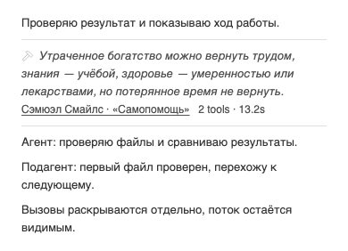
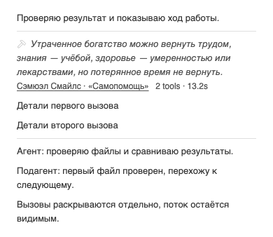

# Minus — разделители вокруг группы вызовов

Владелец принял показанное превью и поручил: «Примени разделители и установи обновление». Текущая визуальная основа — компактный серый ряд BB 0.48.0 из [предыдущей редакции](2026-10-30-padding.md), дополненный именно принятыми верхней и нижней линиями. Цитата → русский автор/источник → количество инструментов и время; поток агента остаётся снаружи группы.

## Реализация принятого варианта

В закрытом виде две прямые линии обрамляют сводку. В раскрытом нижняя линия находится под последним смонтированным вызовом, включая смену последнего вызова при виртуализации. Ряды React не перемещаются в новые wrappers и их стили не перезаписываются: Minus добавляет только собственный декоративный end marker с aria-hidden и пропускает его при DOM-группировке. Cleanup удаляет header/end markers и восстанавливает скрытые строки.

| Роль | Рецепт и источник |
|---|---|
| Разделители | Нативный border recipe BB: 1 CSS px и `var(--border)` |
| Общая ось | Принятые 2 × `--spacing` = 8px в текущей теме; header margin вместо padding, текст остаётся на прежней оси |
| Отступ к верхней/закрытой нижней линии | 2 × `--spacing`, как в принятом превью |
| Нижняя линия раскрытой группы | Собственный sibling после последнего вызова; существующий native timeline gap даёт те же 8px перед линией |
| Текст и фокус | Прежние text-muted-foreground, text-sm/text-xs, leading-5 и native focus-visible ring |

## Состояния и устранённые дефекты

Ревью обнаружило прежнюю коллизию: отдельные DOM-части pending/stale API-run могли получать один ключ, перемещать header между собой и непрерывно планировать RAF. При неоднозначном полном run каждая часть использует отдельную fallback-идентичность и счётчик смонтированных вызовов; время честно недоступно до однозначного API-индекса. Непроверенный spacer и поток не скрываются.

Последний явный выбор раскрытия сохраняется по членам показанной группы, включая виртуализированные строки. Состав API-группы закрепляется на отрисованном header через WeakMap: отказ/замена API между кликом и очередным RAF не отменяет выбор пользователя. При смене fallback/API header сохраняется фокус кнопки или источника без прокрутки.

## Проверки этой редакции

- 37 DOM/подборочных тестов, strict TypeScript, plugin build и diff-check прошли. Новые регрессии проверяют end marker при добавлении/удалении строк; независимые группы вокруг stream; прекращение самопланирования observer; возврат строки после явного collapse; API error до/после выбора; click после reject до RAF; фокус кнопки/ссылки и cleanup.
- 352 browser cases / 1408 settled-состояний: все 73 цитаты, поля728/358/288, light/dark, fine/coarse,100/200% текст, known/zero/pending/unknown time, closed/focus/open/recollapsed. Проверены обе линии, позиция end marker, переносы, inset, native gap и видимость stream.
- Четыре actual-module PNG closed/open в light/dark побайтно совпали с одобренным превью.200% dark также проверен визуально. Метод — isolated headless Chromium; физический телефон и реальная делегированная сессия здесь не проверялись.
- Независимое read-only ревью /root/wrap_quotes_review не обнаружило P0/P1/P2 на финальных group-tools.ts `d89765c6bbc6db8bed6e8523e92289bfa57d38696600f580aa077ad5cc407de3` и тестах `626a1a40e434aa1349f4db5629906e35fda99d3f87f783a084f1297bb3429ace`. Остаточная API-membership race воспроизведена до исправления и снята целевыми повторными пробами.

Применены bb-plugin-workflow, bb-plugin-authoring, Impeccable / layout / Operate и Frontend Design. Дизайн-оценка проводилась независимо от mechanical scan; regex scan TS не выдаётся за браузерный аудит. quotes.ts, SDK pin 0.6.79, manifest, backend и настройки не менялись. Workflows в текущей ветке, upstream main и fork main отсутствуют; GitHub Actions не запускались.

## Evidence и доставка

[JUnit](verification/2026-10-30-dividers/tests.xml), [геометрия](verification/2026-10-30-dividers/layout.json), [browser script](verification/2026-10-30-dividers/browser.mjs), [SHA256](verification/2026-10-30-dividers/source-hashes.json), [unified diff от11632c9](verification/2026-10-30-dividers/source.diff).

Установка прямо разрешена. До её выполнения активны source11632c9949814db273b5e9dc6aae2ea7d1fb77d1 и bundle211e552cd0e19515; откат — этот точный source с актуальными boolean settings штатным CLI. Фактическая установка, jobs, config/read-back и live-проверка фиксируются отдельно локальными квитанциями. Общий BB/runtime не останавливается и не перезапускается. Исходники BB/SDK/vendor/cache не меняются; штатная managed установка создаёт свой артефакт.

Созданы эта запись и каталог безопасных fixture-evidence. Реальные snapshots общего BB остаются локальными и в публичный PR не включаются. PR #2 по-прежнему открыт; merge не выполняется. Описание PR остаётся отдельной операцией внешней отправки и не обновляется без согласия на актуальный полный текст.
