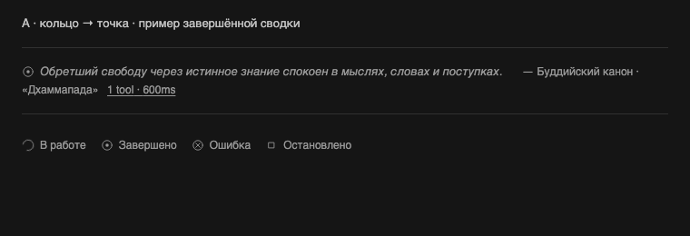
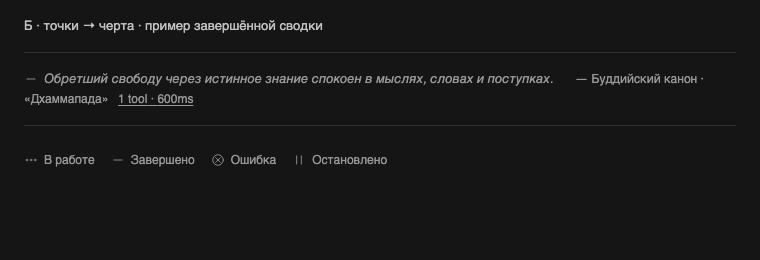

# Итоговое время и единая строка цитаты

Владелец показал повтор цитаты между несколькими пачками вызовов и уточнил: секунды нужны только после завершения цикла. Затем попросил убрать ссылку источника и перенос перед ним, чтобы цитата и авторство читались одним предложением. Для новых значков явно поручено предварительное согласование: галочки и «!» не приняты.

## Готовая редакция времени и строки

Во время подтверждённого pending показывается только количество инструментов. Промежуточное elapsed-время больше не вычисляется по текущим часам. После terminal refresh появляется сумма завершённых интервалов, включая участников составной native summary; пока хотя бы один выполняется, ни частичная сумма, ни разделительная точка не видны.

Источник стал обычным inline SPAN без URL, target, подчёркивания и отдельного tab stop. Цитата, авторство и метрики образуют единый текстовый поток без BR/блочного переноса. Естественное перенесение при сужении поля сохраняется. Native icon-button связан с inline LABEL цитаты/автора; метрики остаются второй native-кнопкой. Так авторство может продолжать последнюю строку цитаты, без атомарного прямоугольника многострочной кнопки. LABEL активирует кнопку один раз; accessible name совпадает с видимой подписью через aria-labelledby. Цвет, размеры, разделители и принятые отступы сохранены.

Сам текст словаря не менялся. Нажатие авторства теперь действует как нажатие цитаты, без открытия внешнего сайта.

## Локализация скриншота

Источник найден штатным поиском по редкой фразе пользовательского сообщения, без вопроса владельцу. API подтвердил 18 разных инструментальных work-строк и отдельную delegation; три сводки на изображении относятся к разным пачкам, а общий текст цитаты сохранялся при разбиении fallback-группы по API-границам. Повторного исполнения/одинаковых API IDs проверка не установила. Границы reasoning/сообщений/делегирования этой редакцией не меняются. Приватные timeline/DOM и скриншот владельца остаются в thread storage, не публикуются.

## Выбор значков: пока только предложения

Владелец явно потребовал согласование. `ACTIVITY_ICONS` остаётся прежним до его выбора; демонстрационные SVG подменяются только в изолированном preview, без установки в BB.

- **А — кольцо → точка (рекомендация):** во время работы вращающееся кольцо; по завершении круг с точкой. Ошибка — крестик в круге; остановка — квадрат.
- **Б — точки → черта:** во время работы три пульсирующие точки; по завершении горизонтальная черта. Ошибка — крестик в круге; остановка — пауза.

Неизвестный статус не означает завершение: используется статическое нейтральное состояние соответствующего семейства. Оба предложения используют тот же native серый, SVG размер 14 CSS px и прежнюю геометрию. При реализации выбранного варианта motion использует native animate-spin/animate-pulse с reduced-motion и приостановкой вне viewport/в фоне. Preview показывает форму, а готовность нового семейства проверяется после выбора.

## Проверки и стадия

[68 тестов](verification/2026-10-30-final-time-inline/tests.xml), TypeScript и build прошли. [Browser](verification/2026-10-30-final-time-inline/browser.json) подтверждает отсутствие секунд во время pending, финальные 600ms после terminal, label activation, отсутствие внешних ссылок, native gray/размер и reduced motion. Восемь снимков кандидата сняты local-ui-capture в isolated headless Chromium. Предложения иконок — отдельные preview-снимки, не установленная версия и не подтверждение реального выбора владельца.

Независимый reviewer `/root/icon_review` на точных hashes из [комплекта](verification/2026-10-30-final-time-inline/source-hashes.txt) не нашёл P1/P2. Независимо проверены обычная/составная summary, native label → click/focus, Enter/Space обеих кнопок, Tab только между двумя контролами; восемь PNG совпали с квитанциями. Новые значки reviewer не применял.

`bb-plugin-workflow` / `bb-plugin-authoring`: продолжается текущая ветка и PR #2, manifest/backend/SDK pin/данные не менялись. `impeccable` Operate/harden и `frontend-design`: уменьшена плотность действий, сохранены нативные токены, исправлен inline flow, состояние времени не выдаёт промежуточный результат за итог.

Редакция времени/строки подготовлена и проверена, но ещё не установлена. Работающий source остаётся `9a8c46d92fc66a1d5380cb0412c7eb74afc1608c`, bundle `e3d47ae53f51bdb6`. После выбора значков нужно применить только выбранное семейство, проверить изменённую редакцию и установить единое обновление штатными plugin-командами с read-back настроек/source/artifact. Общий BB не перезапускается. Merge не выполняется. Словарь и чужие изменения исключены.
