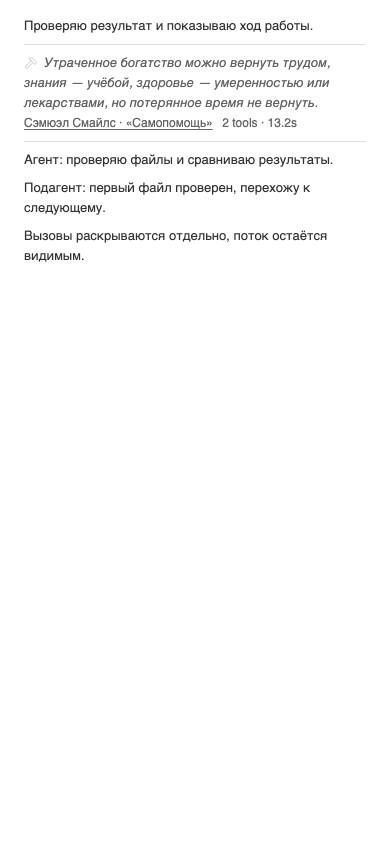
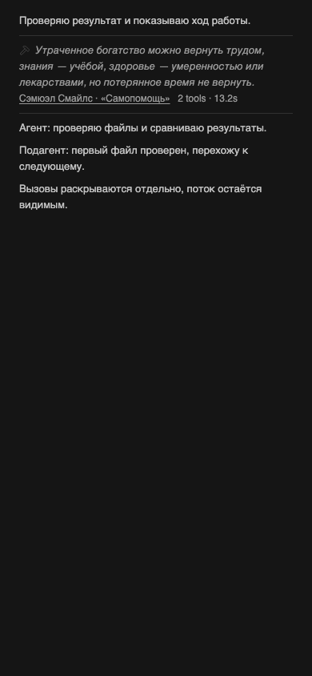

# Minus — родной серый цвет BB

После принятия и установки [разделителей](2026-10-30-dividers.md) владелец уточнил: «Серым цветом как изначально было в бб родной цвет». Основа интерфейса прежняя: цитата → русский автор и источник → количество вызовов и время; верхний и нижний разделители; видимый поток агентов.

В живом BB родной текст подписи work-summary использует `text-subtle-foreground`, хотя внешний контейнер имеет `text-muted-foreground`. Прежняя проверка контейнера не доказывала совпадения цвета его текста. В светлой теме фактически прочитаны `oklch(0.5 0 0)` у родной подписи и `oklch(0.44 0 0)` у Minus.

В собственном шаблоне Minus заменены семь цветовых классов на `text-subtle-foreground`: контейнер, кнопка, иконки, цитата, источник и метрики. Численные цвета не закрепляются в коде: значение приходит из текущей темы BB. Hover и focus сохраняют этот серый цвет; кольцо фокуса остаётся видимым. Разделители уже используют родной `--border` и не меняются. Группировка, перенос, отступы, тексты и настройки не изменены.

## Проверка редакции

37 существующих DOM/content тестов, strict TypeScript и plugin build прошли. Изменены только четыре прежних проверки ожидаемого цветового класса; новые тесты, повторяющие реализацию, не добавлялись.

Изолированный headless Chromium проверил восемь сочетаний светлой/тёмной темы, полей 728/358/288 CSS px и увеличения текста до 200%: закрыто, hover кнопки, keyboard focus, раскрыто, повторно закрыто с hover источника. Во всех 40 состояниях текст совпадает с нативным subtle-токеном, линии — с border-токеном; перенос и видимость потока сохраняются. Размеры взяты из принятой матрицы отступов; новых ограничений продукта нет.

Автоматическая сверка по `bb-plugin-workflow`, `bb-plugin-authoring`, Impeccable / polish / Operate и Frontend Design выполнена для этих байтов. Визуально просмотрены обе темы. Проверяются actual module и CSS текущего BB; это fixture, не физический телефон. Предыдущее ревью группировки и lifecycle остаётся применимым: исполняемый diff меняет только классы цвета.

Независимый reviewer `/root/wrap_quotes_review` просмотрел обе PNG и отдельной пробой проверил цвет шести элементов при idle, hover кнопки/источника и keyboard focus кнопки/источника. Кольца фокуса видны; P0/P1/P2 не обнаружены на хешах, сохранённых в evidence.

## Доказательства и доставка

[Unified diff от 269cd96](verification/2026-10-30-native-gray/source.diff), [хеши исходников](verification/2026-10-30-native-gray/source-hashes.json), [JUnit](verification/2026-10-30-native-gray/tests.xml), [браузерные измерения](verification/2026-10-30-native-gray/browser.json).

Тёмная тема

Обновление прямо поручено владельцем. До активации установлены source `269cd96c107bb42a8eefb3b08a22acc3ae54b585` и bundle `ff40417866494342`. Settings-only backend определяет 31 boolean, не использует storage, secrets, schedules или host entry. Перед штатной заменой pinned source сохраняются и повторно читаются все значения; после — отдельно проверяются source, bundle, jobs, enabled/status, настройки, ошибки и живой цвет. Откат — указанный прежний source и актуальные настройки через штатный CLI. Рабочий общий BB не перезапускается; vendor/cache/SDK вручную не изменяются.

Workflows отсутствуют в рабочей ветке, upstream main и fork main; Actions не запускаются. PR #2 остаётся открытым; merge и обновление текста PR в эту правку не входят. Фактические квитанции активации и живые снимки остаются локальными в thread storage, без публикации рабочих сообщений.
