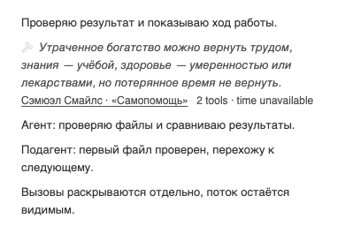
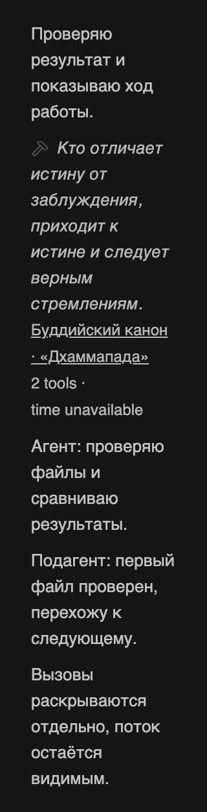

# Minus — устойчивые отступы при переносе и увеличении текста

Владелец продолжил [предыдущую итерацию](2026-10-30-visible-streaming.md): «Да только паддинги аккуратно сделай во всех кейсах с дизайн-скиллами». Сохраняется действующая основа BB 0.48.0 от 2026-10-29 и уточнение от 2026-10-30: цитата → русский автор/источник → число инструментов и время; серый цвет, перенос и видимый поток агентов.

## Подтверждённые причины

Независимый layout-проход Impeccable / Operate и Frontend Design обнаружил, что невидимый chevron при переносе мог занимать собственную строку перед источником. Независимая геометрическая проба воспроизвела это для 7 из73 цитат при ширине поля358px. Расширенная матрица writer также подтвердила переполнение метрик при200% тексте: `count · time unavailable` целиком удерживались на одной строке.

В старой bare fixture не было нативного gap между строками. В реально установленном BB прочитан flex-col timeline с gap8px = 2 × `--spacing`; fixture приведена к этому фактическому рецепту. В код плагина дополнительный вертикальный padding не добавлялся.

## Исправление в принятой основе

| Роль | Рецепт и расчёт | Результат |
|---|---|---|
| Общая горизонтальная ось | Прежний `px-2` ряда и `px-0` кнопки | Цитата, источник и метрики сохраняют единый inset |
| Последнее слово и стрелка | Общий nowrap-контейнер; слово допускает внутренний перенос в inline-block | Стрелка не образует пустую строку |
| Резерв ширины для стрелки | `100% - (svg 3 + margin 1.5) × --spacing` = `100% - 4.5 × --spacing` | Последнее слово со стрелкой помещается и при200% на320px viewport |
| Число вызовов и время | Два отдельных nowrap-span, между ними естественный перенос | Значение остаётся с единицей, вся строка не переполняет поле |
| Межстрочный ритм | Прежние `leading-5` и native timeline gap | Соседний поток остаётся отдельной читаемой строкой |

Ограничение ширины задано inline-стилем только собственного span плагина с семантическим `--spacing`: сгенерированный arbitrary Tailwind utility scoped к plugin-root не действует на маркер, вставленный в native timeline. Исходники/стили BB и SDK не менялись; глобального CSS нет.

## Проверки этой редакции

Test scenarios: обычная/длинная цитата и все73 текста; полный русский источник; широкое728, узкое358 и минимальное проверенное288 поле; light/dark; fine/coarse;100/200% размер текста; известное/нулевое/ожидаемое/недоступное время; закрытие, keyboard focus, раскрытие и повторное закрытие; видимость соседнего потока, сохранение inset и native gap.

Числа ширин — прежние728/358 и поле288 для viewport320 за вычетом двух нативных полей по16px.200% — сценарий увеличения текста. Это размеры проверки, не новые ограничения продукта. Браузерные сравнения допускают1CSSpx исключительно для субпиксельного округления DOMRect.

Нативный chevron имеет transition rotation200ms. Для снимков геометрии тест завершает объявленную CSS-анимацию через Web Animations API: измеряется settled closed/open. В промежуточной фазе rotate bounding box всего SVG может выходить за inset, хотя видимый path внутри; такой промежуточный прямоугольник не объявляется дефектом финального отступа и не маскируется изменением нативной анимации.

Применены `bb-plugin-workflow`, `bb-plugin-authoring`, Impeccable / layout / polish / Operate и Frontend Design. Независимая layout-оценка выполнена до чтения mechanical output. Regex detector для `.ts` не заменяет браузерную проверку. Прежний critique snapshot штатный helper пометил `closed:true` по изменившемуся fingerprint; его историческое содержание не переписано.

28 DOM/подборочных тестов, строгий TypeScript, bb plugin build и diff-check прошли. Итоговый browser-прогон: 352 сценария / 1408 settled-состояний, 0 ошибок. Отдельная проверка реальной CSS-ротации: 7 крайних цитат, оба направления, 333 RAF-кадра; видимый path со stroke и focus ring остаются в пределах ряда. Прежний прогон с 7 неудачными SVG-viewport-bbox assertions сохранён отдельно и не называется успешным. Независимый reviewer подтвердил результат ещё на 26 transition-кадрах.

Read-only ревью /root/wrap_quotes_review не нашло P0/P1/P2 на финальном group-tools.ts SHA256 `3982b41ad69e31ec7d63ee6d30ffa672b112cb6033b28b6033499d99133b7159`; тесты `f14ac67098de81ff712fb671785fbc1dea0e3d0da0f583d5721b6b68a689b45f`. Пять отдельных проб, новые PNG и исходники проверены независимо. Установка отдельно фиксируется локальными source/job/config/live квитанциями. Возобновление не меняет разрешений: обновление Minus поручено; merge и обслуживание общего BB не выполняются.

## Доказательства

[Сводка измерений](verification/2026-10-30-padding/layout-summary.json), [воспроизводимая матрица](verification/2026-10-30-padding/browser.mjs), [проба переходов](verification/2026-10-30-padding/transitions.mjs), [JUnit](verification/2026-10-30-padding/tests.xml), [SHA256](verification/2026-10-30-padding/source-hashes.json), [unified diff от976eeb7](verification/2026-10-30-padding/source.diff).

Узкий экран и увеличенный до200% текст

Метод — isolated headless Chromium с реальным CSS BB. Это изолированная fixture; физический телефон не проверялся. Данные общих рабочих тредов в public evidence не включены. Созданы эта запись и evidence-каталог; из исполняемых исходников меняется только group-tools.ts. Группировка, API, quotes.ts, настройки и SDK pin не менялись. Откат после разрешённой активации — точный предыдущий source976eeb7385196b10c04eb1097ff8ebdc2ddf6fc9 с актуальными boolean settings штатным CLI.
