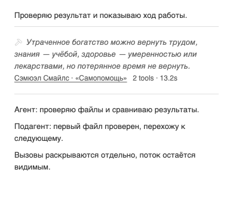
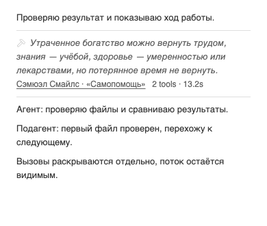
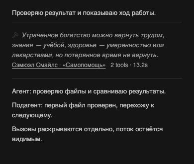
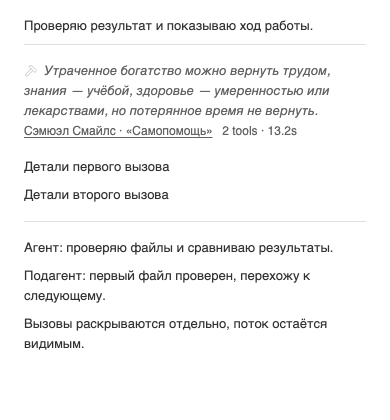
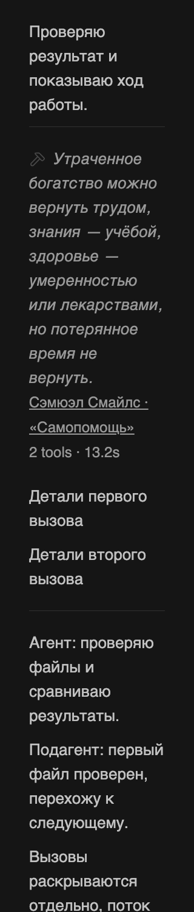

# Minus — больше воздуха после разделителей

Владелец уточнил текущий интерфейс: «больше ещё паддингов после дивайдера чтобы свободнее было читать сейчас сжато слишком». Основа — [установленная редакция с родным серым BB](2026-10-30-native-gray.md), прежние линии и порядок цитата → русский автор/источник → метрики. Меняется только вертикальный ритм группы вызовов.

## Изменение

| Место | Было | Стало | Источник значения |
|---|---|---|---|
| От верхней линии до сводки | 8px | 16px | Удвоение прежних двух шагов нативной сетки до четырёх `--spacing` |
| От сводки до закрытой нижней линии | 8px | 16px | Тот же внутренний ритм |
| После закрытой нижней линии до следующего текста | 8px | 16px | Прежний native gap 8px + собственный нижний padding маркера 8px |
| От сводки до первого раскрытого вызова | 8px | 16px | Native gap + тот же нижний padding маркера |
| По обе стороны нижней линии раскрытой группы | 8px | 16px | Native gap + собственный margin end marker по 8px |

Значения таблицы измерены при обычном размере текста; в коде используются только `--spacing`, поэтому увеличение текста масштабирует их вместе с темой. Горизонтальный inset остаётся прежним. Ряды BB не перемещаются и не получают новые стили; padding/margin добавлены только собственным маркерам Minus. Группировка, виртуализация, выбор раскрытия, цвет, типографика, тексты, settings и SDK не меняются.

## Дизайн и проверка

Impeccable / layout и Frontend Design применены в режиме Operate. Связанные цитата, источник и метрики остаются одной группой; новые интервалы отделяют её от текста агента. На узком экране перенос остаётся внутри прежней ширины, а дополнительное место появляется по вертикали. Отдельная механическая проверка layout не нашла замечаний; она не заменяет просмотр PNG и браузерную геометрию.

Проверены 96 сочетаний восьми длинных цитат/источников, трёх ширин поля 728/358/288, светлой/тёмной темы и 100/200% текста. В каждом проверены закрытие, клавиатурный focus, раскрытие и повторное закрытие — 384 состояния. Время известно либо недоступно. Браузер измеряет внутренние отступы, расстояния до нижней линии и следующего текста, inset, перенос и видимость потока. Все проверки прошли. Размеры и zoom взяты из принятой матрицы прежних редакций, новых ограничений продукта нет.

37 существующих DOM/content тестов, strict TypeScript, plugin build и diff-check прошли. Новые тесты, повторяющие CSS, не добавлялись. Просмотрены before/after PNG обеих тем; метод — isolated headless Chromium с actual module и CSS текущего BB. Физический телефон не проверялся.

На независимом read-only ревью выявлен P2 в первом browser-прогоне: измерение не ожидало завершения Enter/Space. В скрипт добавлены явное ожидание нужного `aria-expanded` и проверка соответствия имени состояния. Повторный прогон подтверждает 96/96 раскрытых `open` и 96/96 закрытых `closed`, `focus`, `recollapsed`; геометрических ошибок нет. Первоначальный неполный прогон сохранён локально и не считается PASS. Дополнительно просмотрены PNG раскрытой группы при обычном тексте и 200% в тёмной теме.

Reviewer `thr_bik4dfgafw` независимо подтвердил исправление P2, корректность всех состояний, совпадение evidence и исходников по SHA256 и просмотрел оба раскрытых PNG. Финальный вердикт: P0/P1/P2 в проверенном объёме не обнаружено. Исходники BB, настройки и файлы writer reviewer не менял.

## Доказательства и доставка

[Измерения](verification/2026-10-30-spacious-dividers/browser.json), [воспроизводимый browser script](verification/2026-10-30-spacious-dividers/browser.mjs), [JUnit](verification/2026-10-30-spacious-dividers/tests.xml), [SHA256](verification/2026-10-30-spacious-dividers/source-hashes.json), [unified diff от 9b6d408](verification/2026-10-30-spacious-dividers/source.diff), [mechanical scan](verification/2026-10-30-spacious-dividers/mechanical.json).

До изменения и тёмная тема

Автоматическая сверка с `bb-plugin-workflow` и `bb-plugin-authoring` выполнена для сохранённых хешей. Settings и rails не меняются; существующий вход Settings → Minus сохраняется. Нового поиска готового решения не требуется: это узкая правка принятой реализации.

Продолжается ранее порученное обновление Minus. До активации установлены source `9b6d4084564d6dd10d1b56da847042170b75adad` и bundle `47e2d67648af8d50`; откат — этот exact source с актуальными 31 boolean settings. Перед заменой pinned source сохраняются settings и проверяются jobs; после установки отдельно читаются artifact/source/status/settings/errors и проверяется живой интерфейс. Общий BB/runtime не останавливается и не перезапускается. Vendor/cache/SDK вручную не редактируются. PR #2 остаётся открытым, merge и обновление его текста не выполняются. Живые снимки и квитанции остаются локальными в thread storage.
