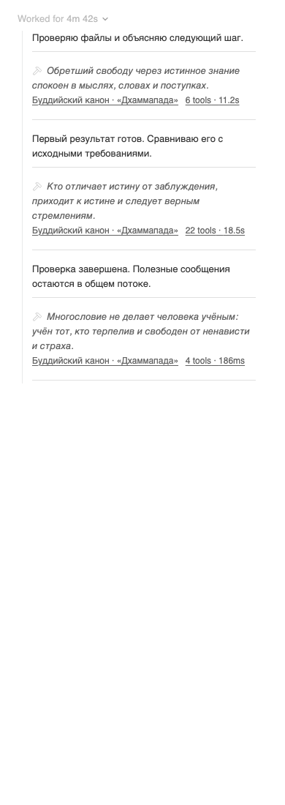
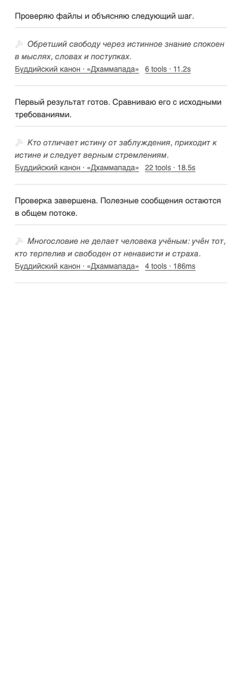

# Minus — сообщения агента вне общей обёртки инструментов

Владелец сообщил: «баг в цитату входит стриминг агентов что плохо» и приложил снимок этапа с общим «Worked for 4m 42s», тремя сообщениями и сводками 6/22/4 инструментов. Это продолжение принятого сценария: сворачивать только вызовы, полезный поток читать отдельно. Визуальная основа — [установленная редакция от 30 октября](2026-10-30-turn-stream-installation.md), родной серый, русский источник и просторные разделители.

## Что установлено

Read-only поиск нашёл точный этап исходного скриншота. В установленной версии `15aa2f6f167d51beb55ae9814e24426cdc15e71b` все три сообщения видимы; нажатие на каждую из трёх цитат их не скрывает. Сообщения не являются DOM-потомками сводок Minus. Поэтому снимок не подтверждает попадание текста под конкретную кнопку цитаты. Подтверждена общая визуальная вложенность всего потока под нативным «Worked for», с отступом и вертикальной линией. Время и число вызовов совпали со скриншотом.

Владелец получил необязательный async-вопрос, чтобы различить два смысла сообщения. После ожидания без ответа writer сообщил рабочее толкование в чате и продолжил исправление общей вложенности в принятом сценарии. Это толкование не записывается как отдельная явная приёмка владельцем.

## Изменение

Когда завершённый верхнеуровневый native turn раскрыт и его непосредственный nested list содержит сообщение агента, Minus скрывает общий заголовок «Worked for». Только промежуточные презентационные div между списком и родным контейнером получают собственную метку и `display: contents`; их декоративная линия исчезает. Сообщения и цитаты читаются на одном визуальном уровне.

Исходные React-строки, список, порядок и контейнер измерения виртуализатора остаются на месте. Сам measure row сохраняет обычный layout и положительную высоту. Каждая цитата и кнопка количества/времени продолжает раскрывать только свою группу инструментов. Родные серый цвет, подписи, метрики, переносы и интервалы сводок не меняются; новых числовых порогов и размеров нет.

Закрытый пользователем native turn сохраняется. Снятие настройки возвращает родное оформление и прежнюю политику cleanup. Если пользователь открывает native turn клавиатурой, фокус переносится с исчезнувшего общего контрола на метрики. Вложенные delegated/workflow timelines не получают такое оформление. SDK, BB, vendor/cache, глобальные настройки и `completedTurnDisplay` не меняются.

## Проверка кандидата

[Точные хеши](verification/2026-10-30-stream-boundary/source-hashes.txt), [diff относительно dc26f97](verification/2026-10-30-stream-boundary/source.diff), [52 теста](verification/2026-10-30-stream-boundary/tests.xml), [проверка настоящего этапа с candidate JS/CSS](verification/2026-10-30-stream-boundary/candidate.json).

| Исходное состояние и действие | Проверенный результат |
|---|---|
| Exact этап скриншота, инструменты закрыты | Три сообщения видимы, общего визуального контейнера нет |
| Каждая из трёх цитат: Enter, затем Space | Все сообщения остаются видимыми вне сводок |
| Метрики: pointer open, повторный close | Раскрываются только инструменты |
| Exact история, 1280 | Native header скрыт, outer measure row имеет положительную высоту, wrapper seam отсутствует |
| Закрыть native turn, затем открыть с фокусом | Явный выбор сохраняется, фокус переходит на метрики |
| Cleanup | Собственные метки снимаются, React-строки не перемещены |
| Delegated timeline | Новое оформление не применяется |

52 теста, strict TypeScript, plugin build и diff-check прошли. Первая редакция нового теста упала из-за чтения fixture shell до его монтирования; тест исправлен, первоначальный FAIL сохранён локально и не засчитан как PASS.

Impeccable / harden / Operate и Frontend Design применены к действующей основе: общая визуальная вложенность не должна связывать обычные сообщения с деталями инструментов. Просмотрены восемь before/after PNG: обе темы, 1280×900 и 390×1100. В узкой версии после снятия лишнего отступа текст получает нативную доступную ширину; цитата, источник и метрики по-прежнему переносятся без обрезания. Полная прежняя матрица 96×4 не повторялась: разметка сводки и её интервалы не менялись.

Снимки используют [обезличенную действующую нативную оболочку](verification/2026-10-30-stream-boundary/fixture.html), [fixture timeline](verification/2026-10-30-stream-boundary/fixture-timeline.json), реальные before/current модули и CSS BB; [скрипт](verification/2026-10-30-stream-boundary/visual.mjs). Метод — isolated headless Chromium через штатный `local-ui-capture`. Это отдельное визуальное доказательство. На настоящем историческом этапе текущая редакция полностью проверена в 1280; историческая страница получена документированным olderCursor API и закреплена только в disposable клиенте. Повтор 390 не завершён: новый поток исходного активного треда вытеснил запрошенный исторический turn из смонтированного окна, что подтверждено сохранёнными DOM IDs. Этот timeout не считается PASS и не лечится изменением production-кода. Первоначальная редакция до замечаний P1/P2 проходила обе ширины; после исправлений отдельный свежий native-прогон текущего completed turn без перехвата timeline прошёл в обеих ширинах. Приватные snapshots, исходный HTML и скриншот владельца не публикуются в Git. Физический телефон не проверялся.

## Сверка и доставка

`bb-plugin-workflow` / `bb-plugin-authoring`: проверены принятый scope, публичные контракты, lifecycle, источник и сборка; Settings → Minus сохраняется, новый rails-вход не требуется. `impeccable` / `frontend-design`: проверены иерархия, границы групп, цвет, обе темы, перенос, фокус и очистка оформления. Первое независимое ревью выявило P1: обход оболочек мог пройти за measure row при дополнительном sibling перед native root; P2: без metrics фокус оставался на скрытой кнопке. Исправлены оба случая: проверенный root определяется через native button/header, весь путь предков валидируется до записи и безусловно ограничен самой строкой. Запасная цель фокуса — видимая measure row с обратимым собственным tabindex; cleanup сохраняет исходные null/0/-1 и возвращает фокус на native button. [Пять конечных Chromium-проб](verification/2026-10-30-stream-boundary/edges.json) и четыре независимых DOM-пробы reviewer подтвердили исправление. Итоговый read-only вердикт thr_bik4dfgafw: P1/P2 сняты, новых замечаний в проверенном объёме нет; замороженные hashes подтверждены. [Свежий настоящий completed turn](verification/2026-10-30-stream-boundary/current-native.json) без перехвата timeline отдельно прошёл 1280 и 390 на этой же редакции: общий header скрыт, measure row сохраняет block и положительную высоту, комментарий видим во всех состояниях, quote/metrics работают. На момент этого ревью активация ещё не была выполнена.

Ветка `bb/minus-tool-call-quotes`, PR [#2](https://github.com/n30g30/bb-plugin-minus/pull/2). Общий BB не останавливается и не перезапускается. До установки отдельно читаются source/artifact/status, 31 settings, install/update jobs и health; обратный путь — установленный source `15aa2f6…` с актуальными settings. После установки потребуются отдельное чтение состояния и повтор exact-этапа в живом frontend. Merge не входит в это исправление.

## Установка и отдельная живая проверка

Установлен exact source `3514900c0eb433fa39934cd06b13bf0f25d9789e`, bundle `267bebfe6f3e4272`. Штатное install job `c9edcd1a-3b73-46ab-8b22-63f5f100f200` завершилось `succeeded`. До замены отдельно прочитаны source/artifact, enabled/status, 31 settings и install/update jobs; конфликтующих активных заданий не было. Backend по-прежнему содержит только settings, без storage/secrets/schedules/host entry. Предыдущий source `15aa2f6f167d51beb55ae9814e24426cdc15e71b` и актуальные settings сохранены как обратный путь.

После штатных remove/install восстановлен отличавшийся `collapseToolCalls=true`. [Независимое чтение установленного состояния](verification/2026-10-30-stream-boundary/installed.json) подтвердило правильный source/bundle, enabled/running, statusDetail=null, совпадение всех 31 settings, terminal job, пустой plugin log и health 200. SHA256 установленных исходников совпадают с принятой редакцией; `quotes.ts` побайтно совпадает с прежним source. Словарь не менялся. Общий BB/сервер не останавливался и не перезапускался.

[Установленный frontend на свежем настоящем completed turn](verification/2026-10-30-stream-boundary/installed-native.json) прошёл 1280 и 390 без перехвата timeline или JS/CSS: общий header скрыт, measure row сохраняет block и положительную высоту, внешние контейнеры не получают shell-стили, сообщения остаются видимыми при Enter/Space по метрикам. Page errors отсутствуют. PNG фактического тестового треда обеих ширин просмотрены, сняты штатным local-ui-capture в isolated headless Chromium; приватные кадры и snapshots сохранены локально и не публикуются. Это подтверждение нового свежего этапа; незавершённый исторический повтор 390 отдельно сохраняет свой статус.

Публикация выполнена в прежней ветке и PR #2; merge не выполнялся. Workflows отсутствуют в текущем HEAD, fork main и upstream main, Actions не запускались. Документационное обновление этой записи не меняет исполняемые исходники установленного source `3514900…`. Все собственные браузеры и серверы проверки завершены, локальные зависимости и dist удаляются после проверки. Явная пользовательская приёмка всей новой редакции остаётся отдельной от технической проверки.
