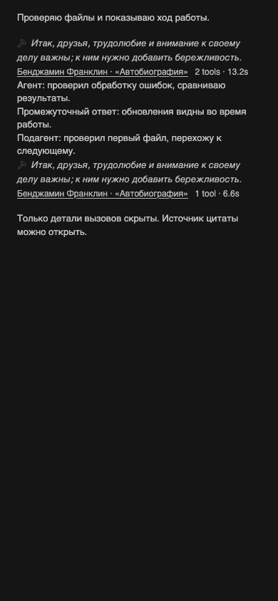

# Minus — видимый поток агентов и порядок подписи

Владелец уточнил в текущем треде: «Цитата, автор а потом количество тулколов и время как сейчас»; полезный стриминг агентов должен оставаться видимым, скрываются вызовы инструментов. Исправление и установка обновления прямо поручены. Предыдущие серый цвет, русский источник и полный перенос сохраняются.

## Принятая визуальная основа

Продолжается [действующая основа от 2026-10-29](2026-10-29-tool-call-quotes.md) — компактная серая нативная tooling-строка BB 0.48.0. Новое решение владельца от 2026-10-30 задаёт последовательность: цитата → русский автор и произведение со ссылкой → число вызовов и суммарное время. Новых иконок, палитры, шрифтов или поверхностей нет. Из предложенных ранее вариантов отступов не вводится hanging indent или отдельный новый блок: исправлен только общий левый край в существующей строке.

| Роль | Нативный рецепт | Проверка кандидата |
|---|---|---|
| Общий горизонтальный отступ | `px-2` у ряда вместо одной кнопки | 2 × `--spacing` (4px) = 8px; кнопка `px-0`; источник и метрики больше не выступают влево |
| Цитата | `text-sm italic leading-5 whitespace-normal break-words` | Native font, 13px / 20px; перенос по ширине поля |
| Автор/источник и метрики | `text-xs leading-5 text-muted-foreground` | Полная русская подпись до метрик, без обрезания |
| Цвет и клавиатура | `text-muted-foreground`, `focus-visible:ring-1 ring-ring` | Idle/hover/focus в обеих темах; Enter раскрывает инструменты, Space сворачивает |

## Причина и исправление

Прежний DOM-классификатор относил к сворачиваемым все строки, не попавшие в список исключений. Рассуждения `op:reasoning` были прямо включены и в DOM-группу, и в API-run. Поэтому их внешний контейнер исчезал вместе с вызовами; неизвестная строка нового stream могла попасть туда тем же способом.

Теперь fallback распознаёт только известные идентификаторы инструментальных строк. Типы API подтверждают принадлежность к работе; рассуждения, системные и неизвестные строки остаются видимы. Делегирование/workflow с агентским потоком и строки ответа пользователя (approval/question/form) исключены из групп. Если рабочая строка позже получает сообщение или вложенную ленту агента, она становится видимой границей и в API-индексе: соседние инструменты получают разные маркеры и независимое раскрытие. Виртуализированное рассуждение также разделяет группы. Через spacer разрешено объединять только две известные строки одного API-run; неизвестный левый вызов не получает права скрыть виртуализированный поток. Прежний сценарий с неизвестной строкой между известными разными run сохранён без ослабления теста: lookahead учитывает следующую известную группу за spacer, останавливаясь на видимом сообщении или системной строке.

## Test scenarios этой редакции

| Сценарий | Наблюдаемый результат | Доказательство |
|---|---|---|
| Закрытая группа до/после API и новые фрагменты stream | Рассуждения и неизвестный поток видны, вызовы скрыты | DOM regression + browser mutation |
| Вызовы по обе стороны stream | Отдельные счётчики/время и независимое раскрытие | DOM + browser |
| Вложенная агентская лента появляется у work-строки | Родитель и текст агента видны, API-группы разделены | DOM regression |
| Reasoning скрыт virtualizer spacer | Соседние вызовы не объединяются через эту границу | DOM regression |
| Делегирование/workflow и взаимодействия пользователя | Поток и вопросы остаются доступными | DOM regression |
| Русский источник на узкой ширине в двух темах | Цитата → автор/произведение → число/time; полный перенос и серый цвет | 32 browser cases |

28 DOM/подборочных тестов, строгий TypeScript, `bb plugin build .` и `git diff --check` прошли. Browser-проверка использует **isolated headless Chromium**, актуальный модуль кандидата и CSS BB: 8 источников × 2 ширины поля (728/358, унаследованы из прежней проверки) × 2 темы. Проверены видимость stream после добавления текста, только три скрытых вызова, два независимых toggle, Enter/Space, focus ring, источник/URL, порядок DOM, общий отступ, отсутствие overflow и muted idle/hover/focus. Это изолированная fixture, не установленный кандидат и не физический телефон.

Применены `bb-plugin-workflow`, `bb-plugin-authoring`, Impeccable / harden / Operate и Frontend Design. Сохранена incumbent-основа; краткая проверка Impeccable detect вернула `[]`, но для `.ts` это только regex scan, а не полноценный браузерный аудит. Независимое read-only ревью /root/wrap_quotes_review не нашло P0/P1/P2 на окончательных байтах: group-tools.ts fbec7e662e05ef778001773b8fb80f0e9c2a06683edc34ae32e04db9f2f3da3d, test f14ac67098de81ff712fb671785fbc1dea0e3d0da0f583d5721b6b68a689b45f. Пять отдельных DOM-проб подтвердили прежние три группы и остановку lookahead перед reasoning, child stream и неизвестным потоком; P2 не повторился. Это ревью переходов состояния и дизайн-сверка исходников; браузерные проверки выполнены writer, installed live проверяется отдельно.

## Evidence и доставка

[JUnit](verification/2026-10-30-streaming/tests.xml), [browser observations](verification/2026-10-30-streaming/layout.json), [воспроизводимый browser script](verification/2026-10-30-streaming/browser.mjs), [хеши](verification/2026-10-30-streaming/source-hashes.txt).

Кандидат продолжает открытую ветку `bb/minus-tool-call-quotes` и PR https://github.com/n30g30/bb-plugin-minus/pull/2. GitHub API подтверждает OPEN: прежнее сообщение о merge не заменяет фактическое состояние. Workflows отсутствуют в текущем кандидате, upstream main и fork main; GitHub Actions не запускаются. SDK pin 0.6.79 не менялся. Исходники BB/SDK/vendor не менялись, общий runtime не перезапускался.

Установка разрешена владельцем; до неё текущий установленный source — `git:https://github.com/vadikhq/bb-plugin-minus.git@21fdfde55660d3bd15f37a40977846483b27b33c`, bundle `0d7aca1f7cab7704`, enabled/running. Откат — тот же точный source с восстановлением актуальных boolean settings. Фактическая активация и live-проверка не считаются завершёнными до отдельных read-back. Точные приватные snapshots общего BB хранятся локально вне публикации.

Созданы эта запись и каталог evidence `verification/2026-10-30-streaming/`; существующие implementation/usage-файлы изменены в Git. Воспроизводимый unified diff относительно предыдущего head сохранён writer до commit; Git diff коммита воспроизводит ту же редакцию.
